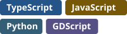

<strong>@Jeyep18</strong> · CS student in the Philippines

<a href="https://johnfrancisespiritu.vercel.app/">Portfolio</a> · <a href="mailto:jfrancis.espiritu@gmail.com">Email</a>

<!-- profile-badges:start -->

  
  
  

<!-- profile-badges:end -->

## Stats and activity

<!-- profile-stats:start -->

### Contribution graph

### Streak activity

Daily counts and language breakdown

- **Daily contributions (UTC)** · Oct 21 (0), Oct 22 (0), Oct 23 (0), Oct 24 (0), Oct 25 (3), Oct 26 (1), Oct 27 (1), Oct 28 (2), Oct 29 (0), Oct 30 (0), Oct 31 (0), Nov 1 (0), Nov 2 (1), Nov 3 (0), Nov 4 (1), Nov 5 (0), Nov 6 (0), Nov 7 (0), Nov 8 (0), Nov 9 (4), Nov 10 (1), Nov 11 (0), Nov 12 (0), Nov 13 (0), Nov 14 (0), Nov 15 (2), Nov 16 (1), Nov 17 (0), Nov 18 (2), Nov 19 (0), Nov 20 (0)
- **Streak activity** · 90 contributions since joining GitHub. Current streak: 1 day. Longest streak: 5 days.
- **Language shares** · TypeScript (57.8%), JavaScript (21.1%), Python (8.4%), CSS (6.8%), PLpgSQL (4.8%), Other languages (1.1%)

[Live contribution calendar](https://github.com/Jeyep18)

Streaks use UTC dates visible in GitHub’s public calendar. A streak active yesterday remains current until today ends. Language shares use GitHub-reported bytes across public non-fork project repositories.
Profile views are proxied badge requests counted by Komarev.

<!-- profile-stats:end -->

## Featured projects

- [**DeMolay Chapter Website**](https://nccdemolay.naga-demolay-120-b0d24c.workers.dev/) · Live chapter site for events and membership info. [Source](https://github.com/Jeyep18/demolay-website-portfolio)
- [**CherIt**](https://github.com/Jeyep18/InnoLab-Hackathon-2026) · Hackathon prototype for sharing lesson packs. [Case study](https://johnfrancisespiritu.vercel.app/cherit.html)
- [**Bagyong Bahay**](https://github.com/Jeyep18/software-eng-fest/tree/dev) · Godot storm-preparation game in development.
- [**TransitPH**](https://github.com/Jeyep18/transit-ph) · Coursework app for finding routes and estimating fares.

## My tools

### Languages

### Frameworks and libraries

### Data and hosting

### Development tools

## About

I’m building stuff rn

<!-- The daily workflow refreshes the marked blocks and analytics SVGs. Font licenses are in assets/fonts/. -->
